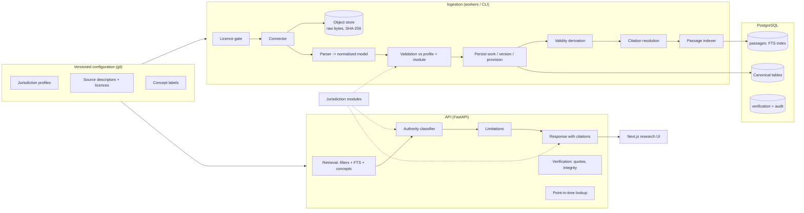

# ULIS architecture

ULIS is legal knowledge and reasoning infrastructure. It is designed to grow, one
jurisdiction at a time, toward global coverage. Each jurisdiction is added only after its
sources are licensed and its results have been reviewed. This document describes the target
architecture and marks what exists today.

> **Current state (Phase 1 + a Phase 2 slice).** The jurisdiction model, core schema,
> provenance, licence-gated ingestion, point-in-time versions, jurisdiction-aware lexical
> retrieval, exact citations and legal-status limitations are implemented and tested against
> a **fictional** sample corpus. No real jurisdiction has been ingested. See
> [roadmap.md](roadmap.md) for what is next.

## 1. Design principles

1. **Jurisdiction rules are data, not code paths.** Courts, precedent doctrine, treaty
   reception, official languages and citation conventions live in versioned profiles
   (`config/jurisdictions/*.yaml`). Behaviour that cannot be data (citation formatting,
   extension validation) lives in versioned jurisdiction *modules*.
2. **Provenance before content.** Every text points to an immutable raw source document
   (SHA-256 addressed). Extracted text, metadata, translations and model output are separate
   layers that never overwrite the original.
3. **Time is a first-class dimension.** Every provision version has a validity interval.
   Queries are answered "as of" a date. The latest text is never assumed.
4. **Authority is contextual.** Whether a passage binds depends on the target jurisdiction,
   the date, the forum court and the profile's rules. It is computed per query and explained.
5. **Say what you don't know.** Coverage gaps, unverified profiles, currency dates, derived
   end dates and un-indexed treatment are reported as explicit limitations.
6. **Licence-gated.** Being publicly accessible never implies permission to ingest. A source
   is ingested only after its licence review is approved.
7. **No premature scale.** PostgreSQL first. A dedicated search engine, vector store or
   partitioning is added only when benchmarks justify it (see §6).

## 2. Module map

| Module | Package | Responsibility | Status |
|---|---|---|---|
| Jurisdiction profiles | `ulis.jurisdictions` | Tree, courts, precedent, treaty reception, coverage | Implemented |
| Jurisdiction modules | `ulis.jurisdictions.modules` | Citation styles, `ext` schemas, profile extensions | Implemented (default, XA, XB) |
| Source registry | `ulis.sources.registry` | Coverage, access, licence; licence gate | Implemented |
| Connectors | `ulis.sources.connectors` | Retrieval only (no interpretation) | `local_manifest`; real connectors planned |
| Parsers | `ulis.sources.parsers` | Source format to normalised model | Akoma Ntoso 3.0 subset |
| Object store | `ulis.storage` | Immutable, content-addressed raw documents | Local FS; S3-compatible planned |
| Ingestion | `ulis.ingestion` | Idempotent, non-destructive pipeline, run records | Implemented |
| Temporal engine | `ulis.temporal` | Validity intervals, point-in-time resolution | Implemented |
| Retrieval | `ulis.retrieval` | Structured filters, FTS, concept expansion, rerank | Lexical implemented; vectors Phase 3 |
| Verification | `ulis.verification` | Quotes, integrity, legal-status limitations | Implemented |
| Reasoning | `ulis.reasoning` | Issue analysis, research briefs, LLM orchestration | Phase 4–5 (not started) |
| Workspace | `ulis.workspace` | Matters, documents, access control | Designed (§5); not implemented |
| API | `ulis.api` | HTTP interface, auth, audit | Implemented (read + verify) |
| Frontend | `Blue-Cat-Web` | Research UI | Implemented (search, provision timeline, coverage) |

The modules are kept separate on purpose. Connectors never interpret text. Parsers never
write to the database. Retrieval never decides authority (the classifier does). The
classifier never formats citations (modules do). Limitations are computed from recorded
facts only.

## 3. Request flow: "what law applied on date D in jurisdiction J?"

1. **Validate** jurisdiction, forum court, languages and limits. A missing jurisdiction
   produces a clarification request, not a guess.
2. **Scope**: J's ancestor chain (legislation whose territorial extent covers J); the
   national court system (case law); treaties to which J's sovereign state is a party.
3. **Temporal filter**: provision versions whose `[valid_from, valid_to)` contains D;
   prospective and proposed texts only on request; later case law kept but flagged.
4. **Lexical match** per language configuration, with curated cross-lingual concept
   expansion (reported to the user).
5. **Authority classification** per hit (binding, vertical precedent, persuasive, treaty
   obligation with domestic-effect note, historical, prospective, proposed, foreign,
   overruled), then reranking by `lexical × authority weight × match type`. All components
   are returned.
6. **Group** parallel language versions of the same provision.
7. **Attach** citation (jurisdiction module), exact text and hash, source document and
   locator, version timeline, judicial and legislative treatment, and limitations.

## 4. Data flow and storage layers

| Layer | Where | Mutable? | Purpose |
|---|---|---|---|
| Raw source bytes | Object store (`sha256:<digest>`) | Never | Evidence; re-derivation; integrity |
| Source document record | `source_documents` | Never | Provenance, retrieval time, licence at retrieval |
| Canonical legal data | `instruments`, `provision_versions`, `judgments`, ... | Append-only; conflicts flagged | Source of truth |
| Derived index | `passages` (tsvector, GIN) | Rebuilt at will | Retrieval |
| Verification and audit | `verification_records`, `audit_events`, `ingestion_runs` | Append-only | Trust, reproducibility |
| Machine output | `translations`, `propositions` (+ support links) | Versioned | Always labelled, never mixed with sources |

## 5. Secure case workspace (designed, not yet implemented)

Lawyers' facts and questions are confidential. The workspace will be a separate bounded
context:

- `matters` (owner organisation, matter number, jurisdiction(s), relevant dates),
  `matter_members` (role-based access), `matter_documents` (encrypted client uploads in a
  separate bucket and key), `matter_research` (saved queries, results snapshots and
  research briefs pinned to corpus versions).
- Row-level security in PostgreSQL keyed on organisation and matter. Every read and write
  is audited. Client documents are never used for model training and are never sent to an
  LLM provider without a data-processing agreement and the organisation's opt-in.
- The public corpus and client matters are physically separate schemas, so retrieval over
  the corpus can never surface another client's material.

## 6. Scaling path (measure first)

| Trigger (measured) | Response |
|---|---|
| p95 search latency over 500 ms at the expected load, or more than about 50M passages | Partition `passages` by jurisdiction (list partitioning); add per-language GIN indexes |
| Need for BM25 tuning, faceting or cross-cluster search beyond what PostgreSQL FTS offers, shown on the evaluation set | Introduce OpenSearch/Elasticsearch as a *derived* index fed from `passages`; PostgreSQL stays canonical |
| Phase 3 embeddings | pgvector (HNSW) until about 10–50M vectors; then a dedicated vector index; embeddings versioned by model id |
| Ingestion backlog | Queue-based workers (one queue per source, rate limits from descriptors); incremental re-indexing by instrument |
| Read load | Read replicas; response caching keyed on (query, jurisdiction, as_of, corpus version) |

Retrieval has a **candidate budget** (`ULIS_RETRIEVAL_CANDIDATE_BUDGET`, default 200) so
reranking cost stays bounded regardless of corpus size.

## 7. Technology

Next.js/TypeScript (frontend); Python 3.11+, FastAPI, SQLAlchemy 2, Alembic (backend);
PostgreSQL 16 (structured data, FTS; pgvector in Phase 3); content-addressed private object
storage; CLI-driven ingestion now, queue workers later. LLM and reranking providers will
sit behind an interface keyed by `provider/model@version`, so every machine output records
the model that produced it.
